<!--
  ┌──────────────────────────────────────────────────────────────┐
  │  Ahmed Anter — profile README                                │
  │  Every animated SVG here is GENERATED daily by GitHub        │
  │  Actions from real algorithms running in Python:             │
  │  Perlin flow fields · K-Means · QuickSort · Conway's Life ·  │
  │  force-directed layout · live GitHub API data.               │
  │  See generators/ — nothing here is a ready-made stats card.  │
  └──────────────────────────────────────────────────────────────┘
-->


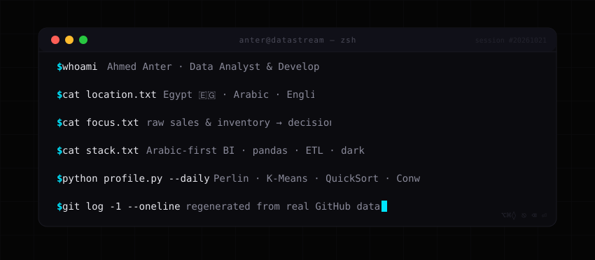

  
  
  
  

 

<!-- // 01 — ABOUT × K-MEANS -->
<table width="100%">
<tr>
<td width="46%" valign="middle">

#### Ahmed Anter · Data Analyst & Software Developer 🇪🇬

- 📍 **Egypt** — open to **Data Analyst / Data Engineer** roles
- 🔭 **Now building:** *Al-Basira*, an Arabic-first BI platform
- 🧮 **Focus:** sales & inventory analytics · dashboards · ETL
- ⚙️ **This profile is generated code** — see the terminal above
- 📫 [xantterx@gmail.com](mailto:xantterx@gmail.com) · [linkedin.com/in/antter](https://www.linkedin.com/in/antter)

</td>
<td width="54%" align="center" valign="middle">
</td>
</tr>
</table>

 

<!-- // 02 — STACK -->

  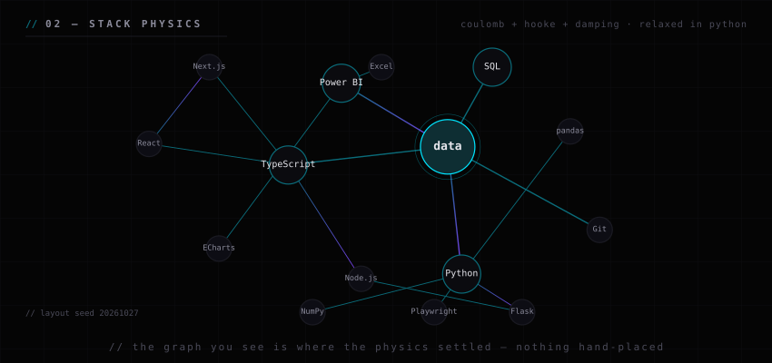 
  <code>// 02 — STACK · layout solved by coulomb + hooke physics in python</code>

  

 

<!-- // 03 — FEATURED PROJECTS -->

<code>// 03 — FEATURED PROJECTS · cards generated, not hand-drawn</code>

<table width="100%">
<tr>
<td width="50%" align="center"><a href="https://github.com/anter-vip/cipherquest">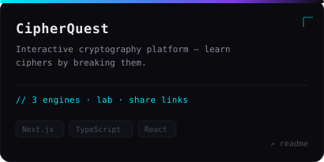</a></td>
<td width="50%" align="center"><a href="https://github.com/anter-vip/bi-platform">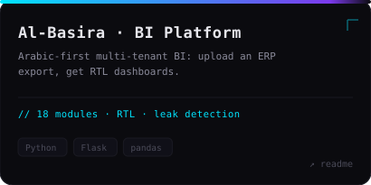</a></td>
</tr>
<tr>
<td width="50%" align="center"><a href="https://github.com/anter-vip/joot">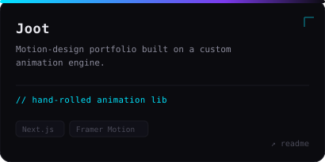</a></td>
<td width="50%" align="center"><a href="https://github.com/anter-vip/khayma-3d">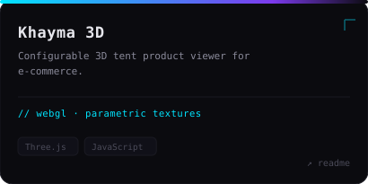</a></td>
</tr>
</table>

 

<!-- // 04 — DATA ON ME -->

   
  <code>// 04 — DATA ON ME · fetched & drawn fresh this morning</code>

  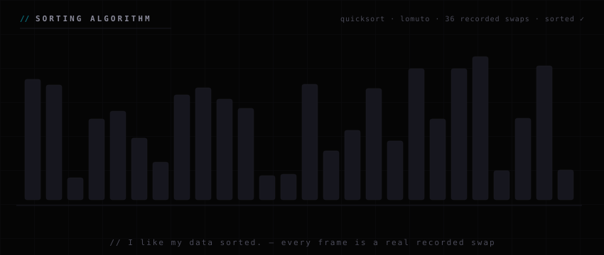 
  <code>// every frame above is a real recorded swap · I like my data sorted</code>

 

<!-- // 05 — ACTIVITY -->

  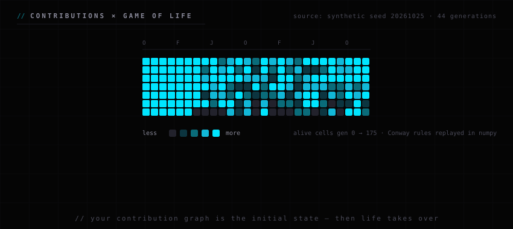 
  <code>// 05 — ACTIVITY · conway life seeded with my contribution graph (graphql)</code>

   
  

 

